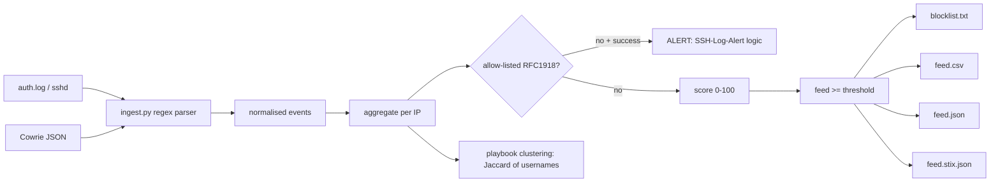

# ssh-threat-feed: SSH honeypot and auth.log to a scored threat feed (txt / CSV / JSON / STIX 2.1)

> **Lab project.** It extends my [SSH-Log-Alert](https://github.com/hustlerx01/SSH-Log-Alert), which emails me about successful SSH logins from non-allow-listed IPs. That project only reacted to *successful* logins. This one turns the *failed* attempts into a threat feed and keeps the success alert.

## Problem
An internet-facing SSH server or Cowrie honeypot logs thousands of failures a day. Blocking every IP that fails once is noisy. Ignoring them throws away intel. ssh-threat-feed parses `auth.log` and Cowrie JSON, scores each source, **clusters IPs that use the same username wordlist** (likely the same botnet or tool), raises an alert on any non-allow-listed success, and publishes a feed that firewalls (txt), analysts (CSV) and TIPs (STIX 2.1) can consume.

## Architecture


**Score (0-100).** Failure volume (40), username diversity (20), invalid-user probing (10), reverse-DNS "BREAK-IN" warning (5), success after ≥5 failures (30), post-login commands (10).

## Run
```bash
pip install -r requirements-dev.txt
pytest -q
python -m sshfeed.cli --authlog data/OpenSSH_2k.log --cowrie tests/fixtures/cowrie.json -o results
python -m sshfeed.cli --authlog /var/log/auth.log --min-score 40 -o feed   # your own server
docker build -t sshfeed . && docker run --rm sshfeed
```

## Results (actual run, 2026-10-11): `results/`
Input: Loghub `OpenSSH_2k.log` (2,000 real sshd lines from a public research honeypot-like server, LabSZ) plus a 30-event synthetic Cowrie fixture. `pytest`: 5 passed.
```
events=1232 unique_ips=29 feed_ips=4 success_alerts=2 playbook_clusters=2
  187.141.143.180  score= 67 fails= 160 users= 28 top=['root','oracle','git']
  183.62.140.253   score= 60 fails= 573 users= 10 top=['root','oracle','zhangyan']
  103.99.0.122     score= 47 fails=  92 users= 19 top=['admin','root','user']
  203.0.113.66     score= 43 fails=   8 users=  1   (Cowrie fixture: brute force -> success -> wget|sh)
  ALERT 119.137.62.142 successful SSH login from non-allow-listed IP after 0 failures (user fztu)
  ALERT 203.0.113.66   successful SSH login from non-allow-listed IP after 8 failures
  cluster ['103.207.39.212', '103.207.39.16']   <- same /24, same wordlist (real data)
  cluster ['198.51.100.31', '198.51.100.32']    <- fixture
```
- 25 real source IPs, of which 3 pass the default threshold of 30. The rest are low-volume probes.
- Clustering found two real IPs in the same /24 using the same username list, without me telling it about subnets.
- The only real `Accepted password` in the log (fztu from 119.137.62.142) is flagged by the SSH-Log-Alert rule. It is probably the legitimate user of that lab server, which shows why the allow-list has to be configured per environment.
- `feed.stix.json` validated by the `stix2` library (4 Indicators plus an Identity).

## Limitations
- The Loghub sample comes from an old research dataset, so its IPs are **stale**. Don't use `results/blocklist.txt` as a live blocklist.
- The thresholds and score weights are my own choices and haven't been tuned against labelled data.
- Clustering on username sets is crude. Password lists, client versions (HASSH) and timing would be stronger.
- The Cowrie data is a synthetic fixture. I haven't deployed a live Cowrie on cloud yet (planned: AWS free tier).
- auth.log timestamps have no year or zone. They're kept as raw strings.
- The Docker image was not built yet.

## Sources
- Loghub OpenSSH dataset (He et al., Loghub, ISSRE 2023): https://github.com/logpai/loghub/tree/master/OpenSSH (SHA-256 in `data/SHA256SUMS.txt`)
- Cowrie event IDs: https://docs.cowrie.org/en/latest/OUTPUT.html
- ShardLure (idea): https://github.com/hett-patell/ShardLure
- STIX 2.1 Indicator: https://docs.oasis-open.org/cti/stix/v2.1/stix-v2.1.html, python-stix2: https://github.com/oasis-open/cti-python-stix2
- MITRE ATT&CK T1110 (Brute Force), T1078 (Valid Accounts)

## Related work

This is my own implementation. Ideas came from ShardLure (hett-patell/ShardLure), which clusters attacker "playbooks".
